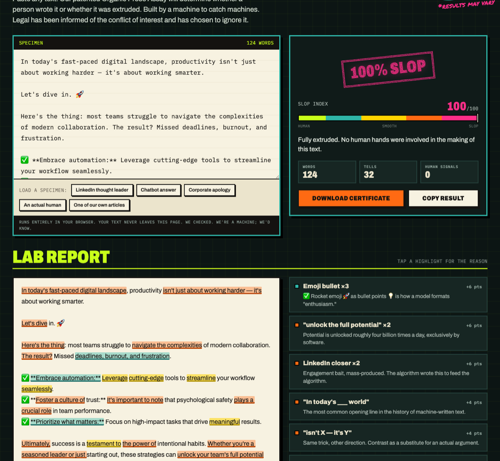
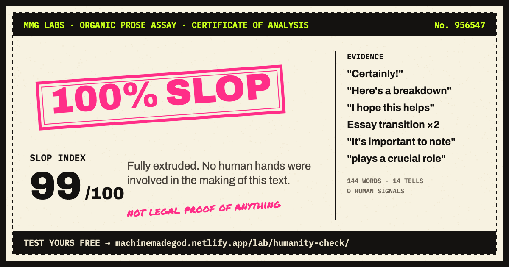

# HUMANITY CHECK™

**Is it human, or is it slop?** Paste text, get a grade from `CERTIFIED HUMAN` to `100% SLOP`, and see every chatbot habit circled with the reason it got flagged.

[**Try it in your browser →**](https://machinemadegod.netlify.app/lab/humanity-check/) · [CLI](#cli) · [GitHub Action](#github-action) · [Library](#library) · [The rules](#how-it-scores)



Made by [MMG LABS](https://machinemadegod.netlify.app/lab/), the software division of Machine Made God, a satire site written entirely by a machine. Yes, a machine built the thing that catches machines. We see no problem.

## What it does

HUMANITY CHECK reads text and looks for the specific habits of machine-written prose:

- **Chatbot residue.** "Certainly!", "I hope this helps", "Here's a breakdown". Text someone forgot to delete.
- **Phrasing.** "It's not X, it's Y". "In today's fast-paced world". "Let's dive in". "The result?"
- **Vocabulary.** `delve`, `tapestry`, `testament`, `multifaceted`, `seamless`, `robust`, `leverage` and about 50 more.
- **Formatting.** Em dashes everywhere, ✅ emoji bullets, `**Bold label:**` bullets, lists of exactly three, and sentences that are all the same length.
- **Human signals.** Swearing, slang, a lowercase "i", "?!". These lower the score.

Each hit adds points. The score is points per 100 words, squashed onto 0 to 100, so a long human essay isn't punished for being long.

| Score | Grade |
| ---: | --- |
| 0–14 | CERTIFIED HUMAN |
| 15–34 | PROBABLY A PERSON |
| 35–59 | SUSPICIOUSLY SMOOTH |
| 60–79 | CORPORATE-GRADE SYNTHETIC |
| 80–100 | 100% SLOP |

There's no AI in here judging the other AI. It's about 90 regular expressions and some arithmetic, all in [`src/rules.js`](src/rules.js), each with a written reason. If a rule is wrong, you can read it, argue with it and send a PR.

## CLI

```sh
npx humanity-check README.md
```

```text
test/fixtures/chatbot-plain.txt
  SLOP INDEX  99/100  ████████████████████  100% SLOP
  Fully extruded. No human hands were involved in the making of this text.

  1:1     residue      "Certainly! "
          Chatbot enthusiasm, still warm from the reply box.
  1:12    residue      "Here's a comprehensive overview"
          Someone forgot to delete the chatbot's intro line.
  3:46    vocabulary   "crucial"
          Everything is crucial in synthetic prose. If everything is crucial, nothing is.
```

| Option | |
| --- | --- |
| `--max-score <n>` | Exit 1 if any file scores above `n`. For CI. |
| `--json` | Full analysis as JSON. |
| `--quiet` | One line per file: score, grade, name. |

It reads stdin too: `pbpaste | npx humanity-check`. Code blocks, inline code and URLs are ignored, so your README's code samples won't count against you.

## GitHub Action

```yaml
name: Humanity Check
on: pull_request
jobs:
  prose:
    runs-on: ubuntu-latest
    steps:
      - uses: actions/checkout@v4
      - uses: AzzamDoesAVbadly/humanity-check@v1
        with:
          files: "README.md docs/**/*.md"
          max-score: 50
```

Every tell shows up as an inline annotation on the pull request, at the exact line and column. Requires Node, which GitHub's runners already have.

## Library

```js
import { analyze } from "humanity-check";

const result = analyze("In today's fast-paced world, let's delve into synergy.");
result.score;        // 0-100
result.grade.label;  // "100% SLOP"
result.findings;     // [{ label, why, category, index, length, match, weight }, ...]
```

No dependencies, plain ES modules. Runs in Node 18+, browsers, Deno, Bun and Workers. `findings[].index` points into the string you passed in, so you can highlight matches in your own UI.

## Honest limits

It measures habits, not authorship. A person who writes like a press release scores like one, and a model told to write like a tired person can pass. Don't use it to fail a student or reject an applicant. Use it on your own drafts, or for fun.

It's tuned for English.

## How it scores

Check the [live rule list](https://machinemadegod.netlify.app/lab/humanity-check/#assay-h), or read [`src/rules.js`](src/rules.js). The calibration samples are in [`test/fixtures`](test/fixtures): three human texts that must score under 15, and three machine texts that must score 80 or more.

```sh
npm test
```

## The certificate

The web app will issue you a certificate. It is not legal proof of anything.



## License

MIT. Do what you want with it, including selling it back to us.
